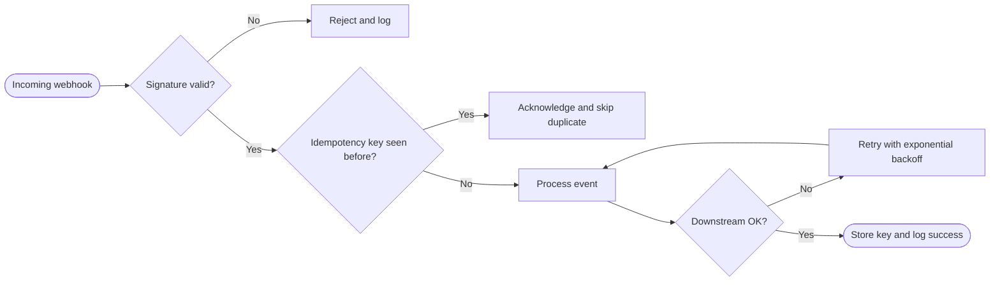

<div align="center">


<a href="https://fasih-alpha.vercel.app/">
  
</a>

<br/>

<a href="YOUR_UPWORK_PROFILE_URL"></a>
<a href="https://fasih-alpha.vercel.app/"></a>
<a href="https://linkedin.com/in/muhammad-fasih-ud-din-b50323323"></a>
<a href="mailto:fasihuddin.moin@gmail.com"></a>

</div>

<br/>

> **I help businesses stop copy-pasting between tools.** I build integrations and automations in n8n, Make and Zapier, drop into custom Python the moment no-code hits its ceiling, and add AI only where it pays for itself.

<br/>

## 👋 About me

<table>
<tr>
<td width="50%" valign="top">

**What I bring**

- ⚡ Fast builds in **n8n, Make & Zapier**
- 🐍 **Custom Python** when a platform can't do it reliably
- 🔐 The unglamorous parts done right: OAuth, API keys, rate limits, pagination, webhooks, retries
- 🛡️ Error handling, logging & security from day one, not bolted on

</td>
<td width="50%" valign="top">

**How I work**

- 🧭 **Honest scoping.** If automation won't help, I'll tell you before building anything
- 📚 **Clear documentation.** You own your system; you don't depend on me
- 🎓 BS Computer Science, ITU Lahore
- 📍 Lahore, Pakistan · working with clients worldwide

</td>
</tr>
</table>

## 💼 What I can build for you

<table>
<tr>
<td width="50%" valign="top">

### 🔗 Integrations
Connect the tools you already run on (**Shopify, Stripe, QuickBooks, HubSpot, Slack, Google Workspace** and more) so data syncs automatically.

</td>
<td width="50%" valign="top">

### ⚡ Workflow automation
Lead routing, invoice follow-ups, onboarding sequences, inventory alerts, built on whichever of **n8n, Make or Zapier** fits your stack.

</td>
</tr>
<tr>
<td width="50%" valign="top">

### 🤖 AI agents & LLM workflows
Support-ticket triage, invoice & document extraction, lead qualification, content repurposing, and human-reviewed auto-replies, powered by **Claude, GPT or Gemini**.

</td>
<td width="50%" valign="top">

### 🐍 Custom Python
For what no-code can't reliably handle: complex auth flows, high-volume webhook processing, custom retry & dedup logic, exposed as clean **FastAPI** services.

</td>
</tr>
</table>

## 🚀 Flagship build: Resilient Webhook Processor

> It started in n8n and hit a wall, so I rewrote the one piece that needed it in Python.
> It's built for integrations that can't afford to **silently drop** or **silently duplicate** an event.



| Feature | Why it matters |
|---|---|
| ✅ **Signature verification** | Only trusted senders get processed |
| ✅ **Idempotency-key dedup** | Retried events never run twice |
| ✅ **Exponential backoff retries** | Downstream hiccups don't lose data |
| ✅ **Full audit logging** | Every event is traceable when debugging |

<p>
  <a href="YOUR_WEBHOOK_PROCESSOR_REPO_URL"></a>
</p>

## 🛠 Tech stack

| Area | Tools |
|---|---|
| **Automation** |    |
| **APIs & integration** |     |
| **Backend** |     |
| **DevOps** |   |
| **AI & LLMs** |     |

## 🔄 How a project with me goes

```
 1. Discover   →  2. Scope honestly  →  3. Build & test  →  4. Document  →  5. Hand over
 your tools &     what's worth          error handling,      runbooks &      you own it,
 pain points      automating (or not)   logging, retries     walkthroughs    no lock-in
```

## 🏆 Certifications

| | Certification |
|:-:|---|
|  | **Google Cybersecurity Professional Certificate** |
|  | **IBM: Generative AI for Cybersecurity** |
|  | **AI Security Specialization** |
|  | **Google AI Essentials** |

<br/>

<div align="center">

### 💬 Have a process that eats hours every week?

**Tell me about it. I'll tell you honestly whether it's worth automating.**

<a href="YOUR_UPWORK_PROFILE_URL"></a>
<a href="mailto:fasihuddin.moin@gmail.com"></a>


</div>
